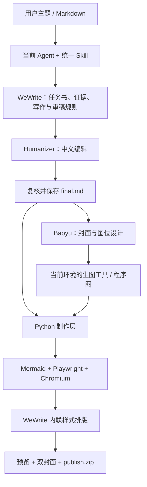

# WeChat Article Workflow

把话题或 Markdown 做成一篇可交付的公众号文章：研究、写稿、中文编辑、事实复核、双封面、必要配图、微信排版和发表文件包。

由当前 Agent 执行写作，复用 **WeWrite + Humanizer-zh + Baoyu Skills** 的规则与工具。本仓库提供统一入口和本地制作层，不额外调用一个写作模型，也不自动公开发表。

## 给其他 Agent 的一句话

> 请读取 https://github.com/zhusihua/wechat-article-workflow 的 README.md，按其中的 Agent 接入流程安装并检查环境，然后读取 workflow/skills/wechat-article-workflow/SKILL.md，用这套流程把我们刚才讨论的内容制作成公众号文章；直接完成能完成的步骤，缺少生图等能力时明确指出，不用占位图冒充完成。

将上面这句话直接交给目标 Agent。首次安装需要联网；目标 Agent 需要文件读写、命令执行、联网研究和图片查看能力，完整封面交付还需要可用的生图工具。“一句话”是任务入口，不代表能绕过目标环境的权限、登录或缺失能力。

## Agent 接入流程

1. 将仓库克隆到用户工作区，或使用已有的完整 checkout。只收到 README 网页时，先取得仓库文件；不要只复制 Skill，因为它依赖本仓库脚本和上游快照。
2. 阅读根目录 `AGENTS.md` 和 `scripts/bootstrap.py`。检查 Python 3.11.5+、Node.js 22+（含 npm）。没有这些基础运行时，按环境允许的方式安装；需要用户授权时具体说明缺少什么。
3. 在仓库根目录执行：

   ```bash
   python3 scripts/bootstrap.py
   ```

   安装器会下载固定 commit 的上游源码、逐文件核对 Git blob SHA-1，创建独立 Python 环境，安装锁定依赖与 Chromium，生成本机 `workflow/runtime.json`，最后做浏览器与 Mermaid 冒烟检查。它不安装全局 Skill，不修改其他 Agent 的个人规则。

4. 读取 `workflow/skills/wechat-article-workflow/SKILL.md`，再读取其中的 `references/agent-adapters.md`。将搜索、生图、文件预览映射到当前 Agent 的可用工具。
5. 开始本篇制作，持续执行到交付或实际能力阻塞。仅讨论话题时不出稿；用户要求“只排版”时不改正文。

macOS/Linux 使用 `workflow/.venv/bin/python`；Windows 使用 `workflow/.venv/Scripts/python.exe`（Windows 尚未端到端验收）。已有 Chrome/Chromium 时可以省去浏览器下载：

```bash
python3 scripts/bootstrap.py --browser "/absolute/path/to/chrome"
```

Linux 若缺 Chromium 的系统库，安装器的浏览器检查会报错；按 Playwright 提示安装系统依赖后重跑。不自动提权。首次下载失败可直接重跑；已核对的上游文件会跳过，被修改的上游文件会报错而非覆盖。

## 如何组合



图为职责与数据流示意。写作、编辑和审稿由同一 Agent 分阶段执行；不是三个模型服务自动互调。

- `projects/`：安装时恢复的上游固定版本；不提交下载的整个快照，不改上游源码。
- `workflow/`：本地制作代码、依赖锁、偏好、统一 Skill 和预览模板。
- `.baoyu-skills/`：项目封面与配图偏好。
- `articles/`：每篇独立目录，默认不进入 Git。

## 会得到什么

- `final.md`：审核后的权威终稿。
- `assets/cover.png`：默认 2.35:1 大封面。
- `assets/cover-square.png`：1:1 小封面，独立重排，短标题与大主体。
- `preview.html`：包含本地图片的预览，可复制标题、摘要和富文本正文。远程图片仍依赖网络。
- `article.html`：带内联样式的微信正文。
- `publish.zip`：发表文件包。
- 文章目录另存任务书、主张与来源账本、初稿、编辑稿、提示词和审核记录。

默认正文不展示参考链接；来源 URL 仍保存在内部 `sources.yaml` 和 `claims.yaml`。必要的归因、日期和不确定性保留为文字。用户要求保留参考链接或仅排版时，以用户要求为准。

## 风格怎么控制

本次要求优先，然后是本篇任务书和 `workflow/preferences.yaml`。默认面向程序员与知识工作者，短句、直接、具体，通常 1200–2200 字。排版主题默认 `professional-clean`；封面默认中性背景与绿色强调。

文风、排版和配图是三个独立设置。没有用户本人样本时不宣称模仿了用户文风；不把一次修改自动升级成全局规则。需要长期改变时修改相应偏好文件。

## 命令与验证

```bash
workflow/.venv/bin/python workflow/wechat.py doctor
workflow/.venv/bin/python workflow/wechat.py new --topic "文章话题"
workflow/.venv/bin/python workflow/wechat.py new --input "/absolute/path/article.md"
workflow/.venv/bin/python workflow/wechat.py render "/absolute/path/to/article-directory"
workflow/.venv/bin/python -m pytest workflow/test_workflow.py workflow/test_portability.py projects/wewrite/tests/test_converter.py -q
node scripts/check_runtime.mjs
```

`new` 不会自动写作；研究、写稿、编辑、审稿和配图由 Agent 完成，再交给 `render`。审稿记录绑定终稿 SHA-256；终稿变化后必须重新审核。`ready=true` 表示本地制作条件满足，不证明事实必然正确、后台或手机验收通过，更不表示已发表。

已提供 GitHub Actions，在 Linux / Python 3.11 / Node 22 上执行安装、单元测试及 Mermaid 渲染与打包冒烟测试。工作流文件存在不代表远程 CI 已运行；实际结果以仓库 Actions 为准。

## 生图与发表边界

优先使用目标 Agent 的原生生图工具；已有授权和配置时可选其他后端。仓库不附送生图模型、API key 或额度。没有后端时保存提示词和已完成内容，明确双封面仍缺失，不把占位图片当作真实成品。

默认本地交付。只有用户明确要求“放入草稿箱”且配置可用时，才调用 `draft`。凭据保存在环境变量或本地 `workflow/state/config.yaml`，不发到聊天或 Git。本入口不调用公开发表或群发接口。上传结果未知时不自动重试，先核对公众号后台。

## 上游与许可

本仓库集成代码采用 MIT。上游项目保持各自许可证；固定版本和来源见 [projects/SOURCES.json](projects/SOURCES.json)，完整文件校验清单见 `workflow/source-trees.json`。

| 项目 | 使用部分 | 固定 commit |
|---|---|---|
| [WeWrite](https://github.com/imraywang/wewrite) | 写作与审稿规则、排版和可选草稿 API | `95f4d507fb789c695c61cdf0d54bd1ee0fcfd117` |
| [Humanizer-zh](https://github.com/op7418/Humanizer-zh) | 中文编辑规则 | `f4518a8eab97b8bfebc66a89d34320a89bef6930` |
| [Baoyu Skills](https://github.com/JimLiu/baoyu-skills) | 封面和正文图位设计 | `1567581c26ec29f4216c6e6835415bf30343b0e3` |

迁移边界和环境验证记录见 [docs/portability.md](docs/portability.md)。
